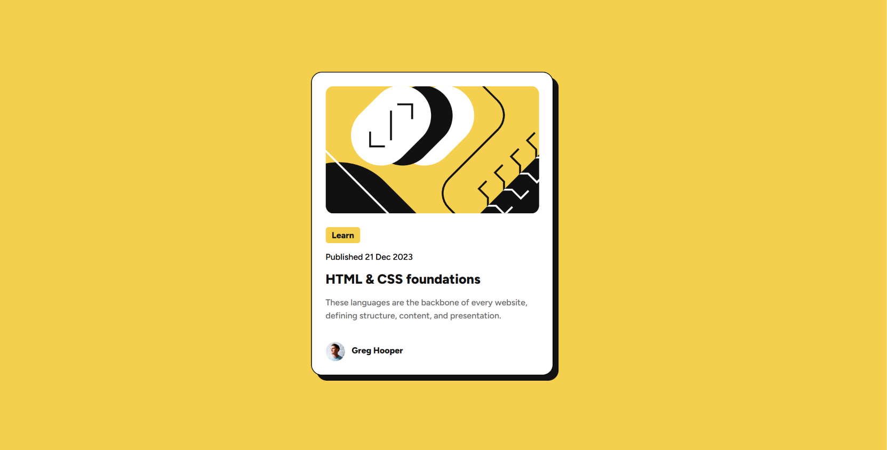

# Blog Preview Card

This is my solution to the [Frontend Mentor Blog preview card challenge](https://www.frontendmentor.io/challenges/blog-preview-card-ckPaj01IcS). I used HTML and CSS to build a card containing an article illustration, category label, publication date, title, summary, and author information.

My goal was to get as close to the design as possible while practicing layout, typography, spacing, and how the page behaves at different screen sizes.

## Table of contents

- [Overview](#overview)
- [Screenshot](#screenshot)
- [Built with](#built-with)
- [Development process](#development-process)
- [What I learned](#what-i-learned)
- [Continued development](#continued-development)
- [Useful resources](#useful-resources)
- [AI collaboration](#ai-collaboration)

## Overview

The page displays an article preview in a white card with rounded corners, a border, and a solid shadow against a yellow background. I focused on:

- Adjusting the card's position, dimensions, and spacing to match the design.
- Using the local Figtree font and setting text colors, sizes, weights, and line heights.
- Centering the category label's text and aligning the author's avatar and name.
- Adding a color change when hovering over the article title.

The main static layout is complete. Smaller screen layouts and keyboard interactions still need further work.

## Screenshot

The current desktop layout:

## Built with

- HTML5 to structure the images, heading, paragraphs, and author information.
- CSS for colors, typography, dimensions, spacing, rounded corners, borders, and shadows.
- Flexbox to center the card and label text and arrange the author information.
- The local Figtree variable font, loaded with `@font-face`.
- Cursor and Live Preview for editing and previewing the page.
- Chrome DevTools for inspecting styles and testing different viewport sizes.

To preview the page in Cursor, open `index.html` and click **Show Preview** in the editor toolbar. You can also right-click the file in the file explorer and select **Show Preview**.

## Development process

1. Built the card container and added the page background and basic card styles.
2. Adjusted the parent container's height and used Flexbox to center the card.
3. Added the illustration, category label, publication date, title, summary, and author information.
4. Loaded the local font and adjusted typography, padding, margins, and the alignment of the avatar and name.
5. Added the card shadow and title hover effect, then checked the layout in the preview.

## What I learned

### Vertical centering needs room in the parent container

At first, setting `align-items` did not vertically center the card as I expected. I found that `body` did not fill the viewport's height, and the percentage height I had set was not working as intended.

Setting the minimum height of `body` to `100vh` gave the parent enough space for vertical centering. For the card itself, I combined `height: auto` with `min-height` to keep a minimum height while allowing content in normal flow to make the container taller.

I also learned that a background covering the page does not mean that `body` itself fills the viewport. When `html` has a transparent background and no background image, the browser uses the background of `body` for the page canvas.

### Unexpected spacing can come from browser defaults

There was a gap between the image and a paragraph even though I had not added one. I discovered that browsers give `
` elements default top and bottom margins.

This helped me distinguish between a parent container's `padding` and a child element's own `margin`. Padding adds space inside an element, while margin adds space outside it. Neither is inherited by child elements by default.

### Align items through their shared parent container

I initially used `text-align` to center the category label's text. It handled horizontal alignment, but did not vertically center the text within the label. Switching to Flexbox let me center it in both directions.

For the author information, I placed the avatar and name inside a shared container, used `align-items` for vertical alignment, and adjusted the space between them with `gap`. This taught me to identify the shared parent first when arranging multiple elements.

### CSS pixels and screen pixels can differ

I once set a label to `100px × 40px`, but a screen ruler measured it as `150 × 60`. I confirmed that Windows display scaling was set to 150%.

I learned to check layout dimensions with browser developer tools instead of relying only on a screen ruler. This helped me avoid changing the design dimensions just to compensate for system display scaling.

### Responsive spacing can have a lower limit

I wanted the card's padding to change with its parent container's width while keeping enough space on smaller screens. I used `max(1.5%, 20px)` as the value of `padding`.

The `max()` function selects the larger value. When the percentage resolves to more than 20px, the padding continues to change with the available width. When it resolves to less than 20px, the padding stays at 20px. I also learned about `min()` for an upper limit and `clamp()` for both lower and upper limits.

Another issue was a background color that did not appear because I had typed an extra closing parenthesis. It reminded me to check syntax before assuming that a problem comes from the layout.

## Continued development

- Test smaller viewports and refine widths, padding, and minimum dimensions to reduce horizontal overflow.
- Learn more about semantic HTML and add appropriate links and keyboard focus styles where interaction is needed.
- Check the font's supported weight range and refine typography and spacing to better match the design.
- Organize CSS declarations by layout, dimensions, typography, and appearance to make them easier to find and edit.
- Become more comfortable with multiple cursors, batch editing, and entering relative file paths in the editor.

## Useful resources

- [MDN: @font-face](https://developer.mozilla.org/en-US/docs/Web/CSS/Reference/At-rules/@font-face) — Explains how to declare and use local fonts.
- [MDN: The p element](https://developer.mozilla.org/en-US/docs/Web/HTML/Reference/Elements/p) — Helps explain paragraph elements and their default presentation.
- [MDN: max()](https://developer.mozilla.org/en-US/docs/Web/CSS/Reference/Values/max) — Explains how to give responsive spacing a lower limit.
- [MDN: clamp()](https://developer.mozilla.org/en-US/docs/Web/CSS/Reference/Values/clamp) — Explains how to constrain a value between lower and upper limits.
- [Chrome DevTools: Device mode](https://developer.chrome.com/docs/devtools/device-mode) — Shows how to check a page at different viewport sizes.

## AI collaboration

I used ChatGPT to help me understand CSS concepts and investigate layout issues. I then applied the suggestions myself and observed how the page changed. Our discussions covered centering, default margins, loading fonts, pixel scaling, and aligning an avatar with a name.

Breaking problems into small steps and checking the results was especially useful. I also found that screenshots alone were not always enough to identify the cause of a problem; the current code and browser developer tools provided better context.

This README was based on my development notes, with AI assistance to improve the wording and organization.
